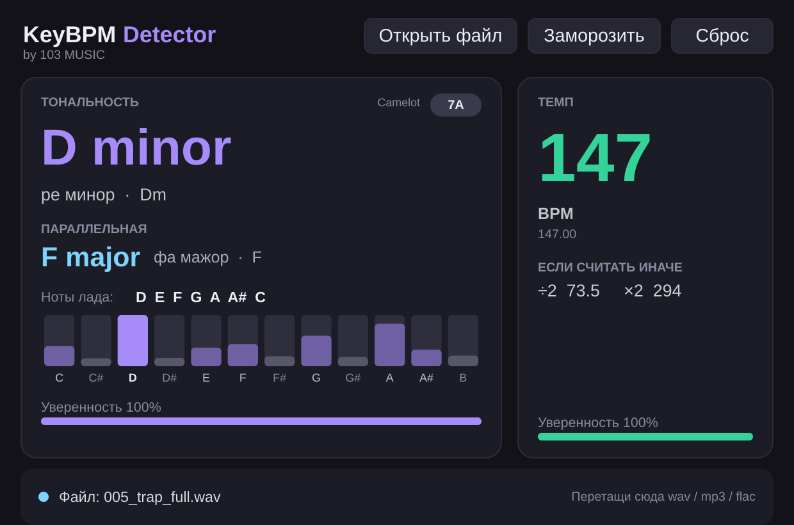

# KeyBPM Detector

Плагин для FL Studio (VST3, на Mac ещё AU) и отдельная программа: определяет **тональность**, **параллельную тональность** и **темп (BPM)**.



## Что показывает

- **Тональность** — например *D minor* (ре минор, Dm), код Camelot.
- **Параллельную тональность** — *F major* (фа мажор). Между ними алгоритмы чаще всего путаются, поэтому показываются обе.
- **Ноты лада** и столбики: насколько часто звучит каждая нота.
- **Строй** — если сэмпл расстроен (например, +27 центов), это будет видно.
- **BPM** с точностью до сотых, плюс варианты ÷2 и ×2 и сравнение с темпом проекта.
- **Уверенность** для каждого результата.

## Как пользоваться

1. Повесь плагин на канал микшера (или на Master) и включи воспроизведение.
   Темп появится через ~5 с, тональность — через ~10 с, дальше результат уточняется.
2. Или перетащи аудиофайл (wav / mp3 / flac / ogg / aiff) прямо в окно — анализ всего файла за пару секунд.
3. **Сброс** — начать заново (когда включаешь другой трек), **Заморозить** — зафиксировать результат.

Результат сохраняется в проекте FL.

## Скачать

Раздел **Releases** справа → архив для Windows или Mac → внутри `INSTALL.txt` с инструкцией.

## Как это работает

- **Тональность:** спектр 8192 точки → отделение гармонических звуков от ударных (HPSS) → пики спектра →
  гистограмма нот с шагом 10 центов → автоподстройка строя → сравнение с тремя профилями тональностей
  (Krumhansl–Kessler, Temperley, Sha'ath).
- **Темп:** огибающая атак (spectral flux, шаг ~6 мс) → автокорреляция и гребёнка для грубой оценки →
  точная подгонка сетки долей с шагом 0,005 BPM. Темп приводится к диапазону 82–164 BPM
  (бум-бэп остаётся 82–100, трэп/дрилл — 130–164), остальные варианты показаны как ÷2 / ×2.

Ядро анализа — `Source/core/KeyBpmCore.*` (чистый C++, без JUCE).

## Проверка точности

```
cmake -S . -B build -DKBD_BUILD_TESTS=ON && cmake --build build --target kbd_cli
python3 tests/gen_signals.py testset 40 1
python3 tests/evaluate.py build/kbd_cli testset
```

На 80 синтетических битах (трэп, дрилл, бум-бэп, R&B, поп; 44,1 и 48 кГц; расстроенные сэмплы):
- BPM: 72 из 72 верно (с учётом ÷2/×2), средняя ошибка 0,004 BPM;
- тональность: 66 из 80 точно, 78 из 80 — верная пара «тональность / параллельная».

## Сборка

Собирается автоматически через GitHub Actions при каждом пуше в `main` (Windows и macOS).
Локально: `cmake -S . -B build && cmake --build build --config Release`.
